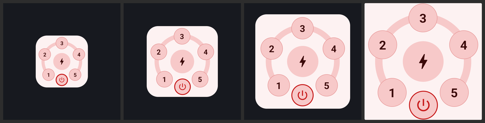
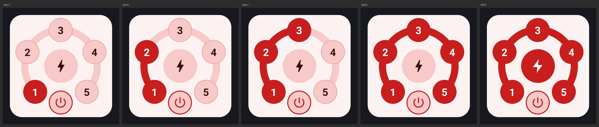

# Pigeon Fan Remote

An Android app that controls a Pigeon BLDC ceiling fan through the phone's
built-in IR blaster, plus a home screen widget that works without opening the app.

Built because no profile in Mi Remote worked with this fan, and the only physical
remote is a single point of failure — the fan powers up in the OFF state, so losing
the remote means losing the fan.

**[Download the APK](https://pigron-bldc-fan.pages.dev/)**



## The protocol

The codes were found by brute-force sweep, not from any remote database, and every
one is verified against the real fan.

| Setting | Value |
|---|---|
| Protocol | NEC |
| Carrier | 38 kHz |
| Address | 0 |

| Function | Code |
|---|---|
| Power | 129 |
| Sleep | 135 |
| Reverse | 136 |
| Light | 140 |
| Boost | 142 |
| Speed − | 146 |
| Speed + | 149 |
| Timer | 150 |

These are specific to this fan's receiver. A different BLDC fan will likely use
the same NEC framing with different command bytes — see **Finding your own codes**.

## Features

- Eight-button remote matching the original handset
- Speed dial with absolute 1–5 selection, which the physical remote cannot do:
  it only has `+` and `−`
- Drag around the arc to set speed
- Home screen widget with the same dial, no app launch required
- Light and dark themes



## How absolute speed works

The fan's receiver only accepts relative speed commands. To reach a known level the
app floors the fan with five `−` presses, then counts up with `+`. That makes speed
selection absolute and correct regardless of what the fan was doing, including after
someone used the physical remote.

The gap between transmissions is 1 ms, tuned empirically on real hardware — low
enough that a full selection is effectively instant.

## Boost

Boost is one-way on this fan: pressing it again does not cancel it. The app models
this, so boost clears only on a speed command (1–5, `−`, or Resync), never by
pressing Boost. Every Boost press still transmits, so a missed signal can be retried.

## Finding your own codes

If your fan is not a Pigeon, the codes here will not work — but the method will.
The screens used to discover them are kept in
[`assets/BldcRemoteLab/`](assets/BldcRemoteLab/README.md): a 0–255 sweep grid that transmits one
command per button and records what the fan did, plus a per-button code editor with
selectable NEC variants. They are not part of the shipped app, but they are complete
and documented.

## Build

```bash
flutter pub get
./build_release.sh
```

APKs land in `outputs/`. Install `*-arm64-v8a.apk` on any modern phone.

The release build is signed with the debug key — fine for sideloading, not for
distribution. Add a keystore and a `signingConfig` in
`android/app/build.gradle.kts` before publishing anywhere.

## Download page

`outputs/index.html` is the download page hosted at
[pigron-bldc-fan.pages.dev](https://pigron-bldc-fan.pages.dev/). The page is
tracked in the repo; the APKs beside it are not, since git would keep every
version of a 15 MB binary forever. Deploy with a direct upload after a build:

```bash
npx wrangler pages deploy outputs
```

## Requirements

- A phone with an IR blaster (developed on a POCO X6)
- Flutter 3.47+
- `android.permission.TRANSMIT_IR`, declared in the manifest and granted at install

## Layout

```
lib/
  fan_profile.dart    verified IR codes
  protocol.dart       NEC encoder
  fan_controller.dart speed/boost state and sequencing
  home_screen.dart    remote UI
  ir_service.dart     MethodChannel to Android
android/app/src/main/kotlin/.../
  MainActivity.kt      ConsumerIrManager bridge
  FanIr.kt             NEC encoder for the widget
  FanWidgetProvider.kt home screen widget
  FanState.kt          state shared between app and widget
```

The NEC encoder exists twice, in Dart and Kotlin, because a home screen widget
cannot run Flutter. Changing a code means changing both `fan_profile.dart` and
`FanIr.kt`.

## Author

Rituraj Shakti — riturajshakti@gmail.com
